 

## 👋 About me

  

<i>Learning by building, breaking and fixing things, and customizing Arch Linux way too much.</i>

## 🛠️ Tech Stack

<table align="center">
  <tr>
    <td align="right"><b>Languages</b></td>
    <td></td>
  </tr>
  <tr>
    <td align="right"><b>Data</b></td>
    <td></td>
  </tr>
  <tr>
    <td align="right"><b>Tools &amp; OS</b></td>
    <td></td>
  </tr>
</table>

## 🚀 Featured Projects

<table>
  <tr>
    <td width="50%" valign="top">
      
      <h3><a href="https://github.com/DJPAA-IB/architect-interior-dashboard">Architect Interior Dashboard</a></h3>
      Studio management dashboard for interior architecture firms: daily reports, projects, invoices, revenue and analytics, in light and dark mode.
        
      
      
      
      
    </td>
    <td width="50%" valign="top">
      <h3><a href="https://github.com/DJPAA-IB/Esprit-PW-2A8-2027-SahaPlus">Saha+</a></h3>
      Digital health platform: interactive body atlas, medical map and blood donation network, mental-health SafeSpace, and a guardrailed AI health assistant.
        
      
      
      
      
        
      Team project · Esprit PW 2nd year · 2026–2027
    </td>
  </tr>
</table>

## 📊 GitHub Activity

  

  <picture>
    <source media="(prefers-color-scheme: dark)" srcset="https://raw.githubusercontent.com/DJPAA-IB/DJPAA-IB/output/github-snake-dark.svg" />
    <source media="(prefers-color-scheme: light)" srcset="https://raw.githubusercontent.com/DJPAA-IB/DJPAA-IB/output/github-snake.svg" />
    
  </picture>

